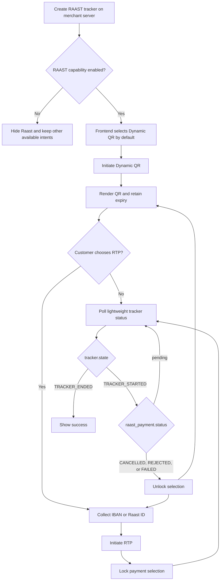

This journey describes the responsibilities of your server and frontend when adding Raast to an embedded checkout alongside card payments.

## Recommended journey

## Server responsibilities

1.  Create the payment tracker with `intent: "RAAST"`, `mode: "payment"`, `entry_mode: "raw"`, and a non-zero PKR amount.
2.  Return the tracker token and a checkout-safe authentication token to the frontend.
3.  Keep merchant secrets on the server. Never embed a secret key in the browser or mobile application.
4.  Confirm the final payment independently in your backend payment processing before fulfilling the order.

## Frontend responsibilities

1.  Check `capabilities.RAAST` before displaying Raast.
2.  Prefer Dynamic QR as the initial Raast option.
3.  Render the returned EMVCo QR payload and retain its expiry.
4.  Offer RTP as an alternative using an [IBAN or Raast ID](/docs/payments/concepts/raast/payer-identifiers).
5.  Lock payment selection once RTP is initiated, and unlock it again once `raast_payment.status` reaches `CANCELLED`, `REJECTED`, or `FAILED` — `tracker.state` alone will not tell you this (see below).
6.  Poll `GET /order/payments/v3/{tracker}/status`. Render checkout success from `data.tracker.state`, but read `data.raast_payment.status` to detect a failed/cancelled attempt and re-enable selection.

## Intent and Raast flow switching

Changing a selected option and initiating a payment are separate events. Keep the checkout flexible until an RTP request is submitted.

| Event                                                | Switching rule                                                                                                                                                                                                                                                                                                                                                         |
| ---------------------------------------------------- | ---------------------------------------------------------------------------------------------------------------------------------------------------------------------------------------------------------------------------------------------------------------------------------------------------------------------------------------------------------------------- |
| The customer has not initiated Raast                 | Switching between card and Raast is allowed.                                                                                                                                                                                                                                                                                                                           |
| The customer selected RTP but has not submitted it   | Switching back to Dynamic QR or cards is allowed — nothing has been sent to Raast yet.                                                                                                                                                                                                                                                                                 |
| Safepay returned a Dynamic QR payload                | The customer can still choose RTP while the QR is awaiting payment. This is a same-intent, same-mode, same-entry-mode request distinguished only by `payload.raast.kind: "RTP"`, so it never goes through generic intent switching — it requires `"action": "CREATE_RAAST_PAYMENT"` at the request root, since `next_actions.RAAST.kind` is `NOOP` once the QR exists. |
| Safepay accepted an RTP initiation                   | Locked. Switching intent, mode, entry mode, or Raast kind is rejected until this RTP reaches a terminal outcome — a real request already went to the payer's bank.                                                                                                                                                                                                     |
| The RTP reaches `CAPTURED`/`SETTLED`                 | The checkout is done — `tracker.state` is `TRACKER_ENDED`.                                                                                                                                                                                                                                                                                                             |
| The RTP reaches `CANCELLED`, `REJECTED`, or `FAILED` | Unlocked again. `tracker.state` stays `TRACKER_STARTED` — check `raast_payment.status` to detect this. The customer may retry RTP (always a fresh request to Raast) or switch back to Dynamic QR, which reuses the original QR rather than generating a new one, as long as it hasn't expired.                                                                         |

<Callout type="warn">
Disable intent and Raast-flow controls immediately after the RTP initiation call succeeds. Leaving them active can present the customer with a choice the current attempt can no longer accept.

</Callout>

<Callout type="warn">
A cancelled, rejected, or failed RTP does **not** move `tracker.state` to `TRACKER_CANCELLED`/`TRACKER_FAILED` — this mirrors how a declined card authorization never changes tracker state either. The checkout stays open (`TRACKER_STARTED`) so the customer can act immediately; you must read `raast_payment.status` to know the attempt failed. Relying on `tracker.state` alone here will look like the request is still silently pending.

</Callout>

<Callout type="warn">
Switching away from a Dynamic QR — to RTP or to another intent — does not cancel it server-side. It remains scannable and payable until its own `expires_at`. This is expected behavior, not a bug: remove the QR from your UI immediately once the customer switches.

</Callout>

## Suggested frontend state model

| Local state      | UI                                                                                                                                                                                                                                           |
| ---------------- | -------------------------------------------------------------------------------------------------------------------------------------------------------------------------------------------------------------------------------------------- |
| `choosing`       | Show all tracker capabilities and allow intent switching.                                                                                                                                                                                    |
| `qr_pending`     | Show the QR and expiry; keep an RTP alternative available.                                                                                                                                                                                   |
| `rtp_collecting` | Collect the payer identifier; allow the customer to go back.                                                                                                                                                                                 |
| `rtp_pending`    | Show an approval prompt, hide switching controls, and poll.                                                                                                                                                                                  |
| `succeeded`      | Show payment confirmation for `tracker.state == TRACKER_ENDED`.                                                                                                                                                                              |
| `unsuccessful`   | Driven by `raast_payment.status` being `CANCELLED`, `REJECTED`, or `FAILED` — not by `tracker.state`, which stays `TRACKER_STARTED`. Offer retry or a switch back to Dynamic QR from here rather than treating it as the end of the journey. |

<Callout type="info">
Do not derive the checkout result from `next_actions.RAAST.kind`. `NOOP` only means there is no synchronous action to execute while the asynchronous Raast payment is pending. Poll `tracker.state` for success, and `raast_payment.status` for a failed/cancelled attempt — the two are independent.

</Callout>

## Testing

Development and sandbox use simulated Raast initiation responses. Use them to verify:

- Tracker setup and capability rendering.
- Dynamic QR rendering and expiry behavior.
- RTP form validation and the post-initiation switching lock.
- Recovering from a cancelled/rejected/failed RTP: confirm the UI unlocks, `tracker.state` never shows a failed outcome, and switching back to Dynamic QR renders the same QR code rather than a new one.
- Lightweight status polling and timeout handling.
- Error UI for malformed requests and unavailable capabilities.

The simulator does not create a real bank payment. Test live Raast completion and asynchronous status updates in the production environment using controlled amounts and accounts.

## Related guides

- [Raast integration overview](/docs/payments/get-started/raast/overview)
- [Dynamic QR](/docs/payments/get-started/raast/dynamic-qr)
- [Request to Pay](/docs/payments/get-started/raast/request-to-pay)
- [Raast payment statuses](/docs/payments/concepts/raast/payment-statuses)
