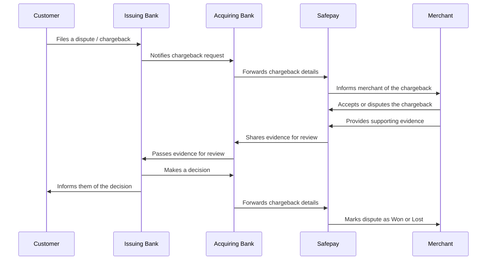

Chargebacks, also known as disputes, occur when a customer challenges a transaction with their issuing bank. Common reasons include:

- Customer was charged twice
- Customer was charged but did not receive goods or services
- Unauthorized use of a card (lost or stolen card)
- Friendly fraud (customer disputes a legitimate transaction)

<Callout type="info">
Safepay has no control over customers lodging chargebacks

</Callout>

## Understanding Chargebacks and Disputes

Safepay actively supports merchants throughout the chargeback and dispute resolution process. Below is a high-level overview of how the chargeback cycle works.

The high level flow above shows the First Chargeback stage. A dispute follows 3 stages:

- First Chargeback
- Pre-aribtration
- Aribtration

Most cases are resolved within the First Chargeback cycle. If a case moves on to Pre-Arbitration, the merchant will get a chance to submit more evidence. If a decision is still not made, then the case moves to the Aribtration stage where the schemes get involved, they review the evidence and make their final decision.

<Callout type="warn">
In the final stage of Arbitration, the schemes get involved and make the final decision and the losing party has to pay a penalty of $500.

</Callout>

As a merchant, if you receive a chargeback/dispute, Safepay will first inform you by email. You can also see any pending disputes on your Safepay Merchant Dashboard.

1

Open Payments 2.0 and click on disputes on the left menu

View your Disputes

2

Click on any dispute to see its details

View the details of the Dispute

3

Decide whether to accept the dispute or submit evidence to fight the dispute.

Accept the dispute by clicking the button

Fight the dispute by submitting evidence

4

If you choose to fight the dispute, submit evidence

Submit Evidence to fight the dispute
