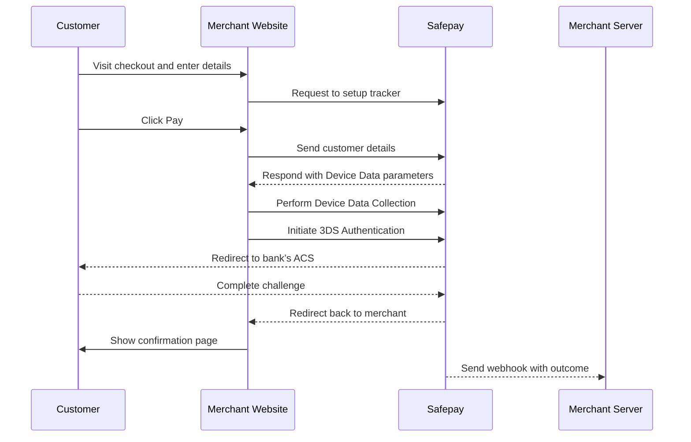

If you want full control over the look and feel of your checkout page, use our APIs to build your own payment form. If you'd rather not build your own payment form, check out our [Express Checkout guide](/docs/payments/get-started/express-checkout).

With our custom API solution, you can accept payments with the following use cases:

- Accept a payment from your customer with their payment details and optionally tokenize the credentials for future payments.
- Accept a payment from your customer using their tokenized credentials.
- Perform an account verification (zero amount authorization) for your customer to tokenize their payment credentials to use for future payments.

## Before you begin

Before you begin to integrate, make sure you have followed the [Get started with Safepay](/docs/get-started/overview) guide to:

- Get an overview of the steps needed to accept live payments.
- [Create](/docs/setup-safepay/create-account/overview) your test account.

After you have created your test account:

- [Get your API keys](/docs/developers/api-credentials/api-keys).
- [Set up webhooks to know the payment outcome](/docs/developers/webhooks/overview).

<Callout type="info">
**Authorization:** Authenticate server-side requests with an API Key header.

- **Key:** `X-SFPY-MERCHANT-SECRET`
- **Value:** `<Your secret key>`

</Callout>

## Accept a Payment with Card Details

### How It Works



1

## Install an API library

We provide two official server-side API libraries for Node and PHP that allow you to interact with the Safepay API easily. Our API libraries will save you time, because they:

- Use an API version that is up to date.
- Provide a simple interface to interact with the Safepay API.
- Handle common errors and exceptions.
- Send the request to Safepay using their built-in HTTP client, so you do not have to create your own.

#### Requirements

- Node.js version 18 or later.

#### Installation

```text
# Install the API library
npm install --save @sfpy/node-core
# Update the API library
npm update @sfpy/node-core
```

2

## Create a payment session

When your customer lands on your checkout page but before they click on the Pay button, you must [create a Tracker](https://apidocs.getsafepay.com/#647f1146-d656-4868-a695-34ad8fcabeb2) with the relevant data. For example:

```javascript title="Create a payment session in NodeJS"
const safepay = require("@sfpy/node-core")("YOUR_SECRET_KEY", {
	authType: "secret",
	host: "https://sandbox.api.getsafepay.com", // for live payments use https://api.getsafepay.com
});

(async () => {
	try {
		const response = await safepay.payments.session.setup({
			merchant_api_key: "YOUR_API_KEY",
			user: "cust_a7cc6fc1-088d-4f35-9dac-2bab2cb234a1",
			intent: "CYBERSOURCE",
			mode: "payment",
			entry_mode: "raw",
			currency: "USD",
			amount: 10000,
			metadata: {
				order_id: "1234567890",
			},
		});
	} catch (err) {
		console.log(err);
	}
})();
```

<Callout type="info">
It’s important to note that linking a Merchant Shopper to a tracker during the setup phase is advantageous as it prevents you from having to pass this information in later stages. To understand how to create and manage your Merchant Shoppers, please refer to our [guide on merchant shoppers](/docs/payments/concepts/shoppers).

</Callout>

3

## Generate a client token

After creating the payment session, the next step is to generate a temporary client token using the [`/client/passport/v1/token`](https://apidocs.getsafepay.com/#d5b420ca-32bf-437a-be9c-ca66ada21110) endpoint.

To do this, you first need to generate a temporary client-side authentication token. Make an API request from your server using one of our SDKs or your own custom solution.

For example:

```javascript title="Create an authentication token in NodeJS"
const safepay = require("@sfpy/node-core")("YOUR_SECRET_KEY", {
	authType: "secret",
	host: "https://sandbox.api.getsafepay.com", // for live payments use https://api.getsafepay.com
});

(async () => {
	try {
		const response = await safepay.auth.passport.create();
	} catch (err) {
		console.log(err);
	}
})();
```

The [`/client/passport/v1/token`](https://apidocs.getsafepay.com/#d5b420ca-32bf-437a-be9c-ca66ada21110) response will give you the authentication token you will need to authorize future requests to Safepay APIs from your website.

For example:

```json title="Authentication token response"
{
	"data": "xnTyRgITVcHlyeKT2cf59_e836PouieQ6xPpuQiwFXD8M6HoJ283EP_zta2SKkm6B_IFNGEBmg=="
}
```

Expiration

A single authentication token lasts for 1 hour. If the authentication token expires, any further requests to the Safepay APIs will result in a 401 Unauthorized error. You must regenerate the authentication token.

4

## Payer Authentication

After creating the payment session and the client side token, the next step is to pass in the customer payment details to the Order API.

| Option                   | Language                                               |
| ------------------------ | ------------------------------------------------------ |
| **Safepay Atoms**        | JavaScript, HTML, and CSS                              |
| **Safepay React Native** | React Native                                           |
| **Cardinal SDK**         | Android (Java, Kotlin) & iOS (Objective c, Swift) only |

Please see the Payer Authentication Methods Available

[

#### Safepay Atoms Web

Accept payments on your website or app.

](/docs/payments/get-started/advanced-checkout/safepay-atoms)

[

#### Safepay React Native

Accept payments on your cross-platform mobile apps.

](/docs/payments/get-started/advanced-checkout/safepay-react)

[

#### Cardinal SDK

Accept payments on your app natively

](/docs/payments/get-started/advanced-checkout/cardinal)
