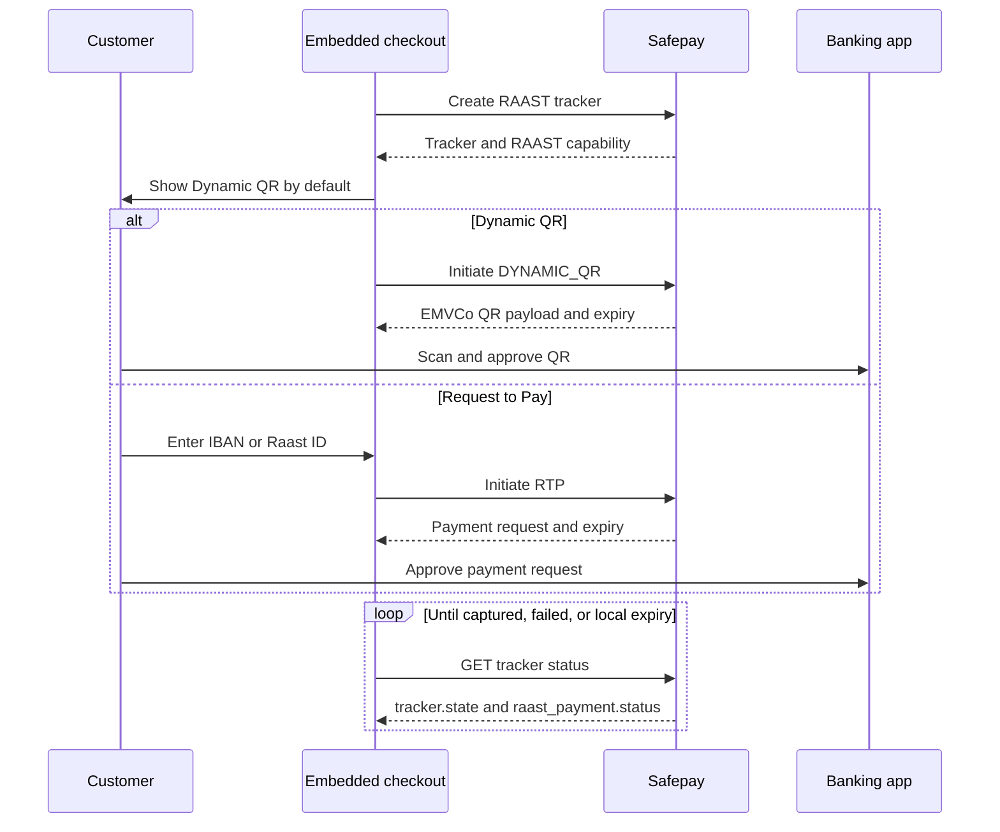

Raast is a first-class Safepay payment intent for accepting PKR payments. You can offer either of these payment experiences:

| Flow                                                              | Customer experience                                                                      | When to use it                                                             |
| ----------------------------------------------------------------- | ---------------------------------------------------------------------------------------- | -------------------------------------------------------------------------- |
| [Dynamic QR](/docs/payments/get-started/raast/dynamic-qr)         | Safepay returns an EMVCo QR payload. The customer scans it with a supported banking app. | Recommended default for the fastest checkout.                              |
| [Request to Pay](/docs/payments/get-started/raast/request-to-pay) | Safepay sends a payment request to an IBAN or Raast ID supplied by the customer.         | Offer when the customer prefers to approve a request in their banking app. |

Both flows are asynchronous. An accepted initiation response means the payment request or QR was created; it does not mean the payment was collected.

## Before you begin

You need:

- A Safepay account enabled for Raast payments.
- Your merchant API key and the authentication token used by your checkout.
- A PKR order amount expressed in minor units. For example, `12500` represents PKR 125.00.
- A checkout that can poll the lightweight tracker status endpoint while the customer completes payment.

<Callout type="info">
Safepay uses a simulated Raast initiation in development and sandbox because the live Raast rail is unavailable there. The API shape is the same, but no real bank payment is created.

</Callout>

## How it works



1

## Create a Raast tracker

Create the tracker from your server. Set `intent` to `RAAST`, `mode` to `payment`, `entry_mode` to `raw`, and use `PKR`.

```javascript title="Create a Raast tracker in NodeJS"
const Safepay = require("@sfpy/node-core");

const safepay = new Safepay(process.env.SAFEPAY_SECRET_KEY, {
	authType: "secret",
	host: process.env.SAFEPAY_HOST || "https://sandbox.api.getsafepay.com",
});

async function createRaastTracker() {
	try {
		const response = await safepay.payments.session.setup({
			merchant_api_key: "YOUR_MERCHANT_API_KEY",
			intent: "RAAST",
			mode: "payment",
			entry_mode: "raw",
			currency: "PKR",
			amount: 12500,
		});
		console.log("Tracker:", response.data.tracker.token);
		console.log("RAAST capability:", response.data.capabilities.RAAST);
		return response;
	} catch (err) {
		console.error("Create Raast tracker failed:", err.message);
		throw err;
	}
}
```

A successful response includes a tracker token and the merchant's Raast capability:

```json title="Raast tracker response"
{
	"data": {
		"tracker": {
			"token": "track_550e8400-e29b-41d4-a716-446655440000",
			"environment": "sandbox",
			"state": "TRACKER_STARTED",
			"payment_method_kind": "wallet",
			"intent": "RAAST",
			"mode": "payment",
			"entry_mode": "raw",
			"next_actions": {
				"RAAST": { "kind": "CREATE_RAAST_PAYMENT" }
			},
			"purchase_totals": {
				"quote_amount": { "currency": "PKR", "amount": 12500 }
			}
		},
		"capabilities": { "RAAST": true }
	},
	"status": { "errors": [], "message": "success" }
}
```

Only show Raast as a payment option when `capabilities.RAAST` is `true`.

2

## Choose the initial experience

We recommend this checkout behavior:

1.  Select Raast and generate a Dynamic QR first.
2.  Render the returned QR payload and show its expiry.
3.  Offer **Pay using IBAN or Raast ID** as an alternative.
4.  If the customer chooses RTP, collect the payer identifier and initiate the request.
5.  Disable payment-method switching as soon as RTP has been initiated.
6.  Poll the lightweight tracker status endpoint until `tracker.state` is `TRACKER_ENDED`, `raast_payment.status` reaches a failure value, or the displayed request expires.

<Callout type="warn">
Do not treat `INITIATED` as payment success. Confirm checkout success only when the tracker state becomes `TRACKER_ENDED`.

</Callout>

## Switching payment experiences

Your checkout can switch between card and Raast intents, and between the two Raast experiences, while no irreversible payment request is in progress — and again once one resolves without success.

| Current checkout state                                  | Can switch? | Frontend behavior                                                                                                                                                                                                                                       |
| ------------------------------------------------------- | ----------- | ------------------------------------------------------------------------------------------------------------------------------------------------------------------------------------------------------------------------------------------------------- |
| No Raast request has been initiated                     | Yes         | The customer may choose cards, Dynamic QR, or RTP.                                                                                                                                                                                                      |
| A Dynamic QR has been generated and is awaiting payment | Yes         | Keep the QR expiry and allow the customer to choose RTP or another available intent.                                                                                                                                                                    |
| RTP is selected but has not been submitted              | Yes         | The customer may return to Dynamic QR or another available intent — nothing has been sent to Raast yet.                                                                                                                                                 |
| An RTP request has been initiated                       | No          | Lock the selection and poll the tracker status.                                                                                                                                                                                                         |
| The RTP is captured/settled                             | No          | Finish the checkout and show success (`tracker.state` is `TRACKER_ENDED`).                                                                                                                                                                              |
| The RTP is cancelled, rejected, or failed               | Yes         | Unlock the selection. `tracker.state` stays `TRACKER_STARTED` for this — read `raast_payment.status` to detect it. The customer may retry RTP (always a fresh request) or switch back to Dynamic QR, which reuses the original QR if it hasn't expired. |

The lock begins when Safepay accepts the RTP initiation request, not when the customer first opens the RTP form, and lifts only once `raast_payment.status` reaches a terminal value — not while it's merely `INITIATED`.

## Poll for the result

Use `GET /order/payments/v3/{tracker}/status` for frontend polling. It returns the tracker plus the current `raast_payment` detail, without loading attempt history or older/superseded payment records — lighter than the full tracker endpoint, but no longer bare.

`tracker.state` and `raast_payment.status` answer different questions and can diverge: a cancelled/rejected/failed RTP does not move `tracker.state` away from `TRACKER_STARTED`, so check `raast_payment.status` directly to detect a failed attempt rather than waiting on tracker state. Also keep `raast_payment.expires_at` from the initiation response as a fallback, since a payment stuck at `INITIATED` past its own expiry isn't distinguished from a still-live one here.

See [Raast payment statuses](/docs/payments/concepts/raast/payment-statuses) for the complete response shape and state mapping.

## Next steps

- Build the recommended [Dynamic QR flow](/docs/payments/get-started/raast/dynamic-qr).
- Add [Request to Pay](/docs/payments/get-started/raast/request-to-pay) as an alternative.
- Review the complete [Raast payment journey](/docs/developers/payment-journeys/raast).
